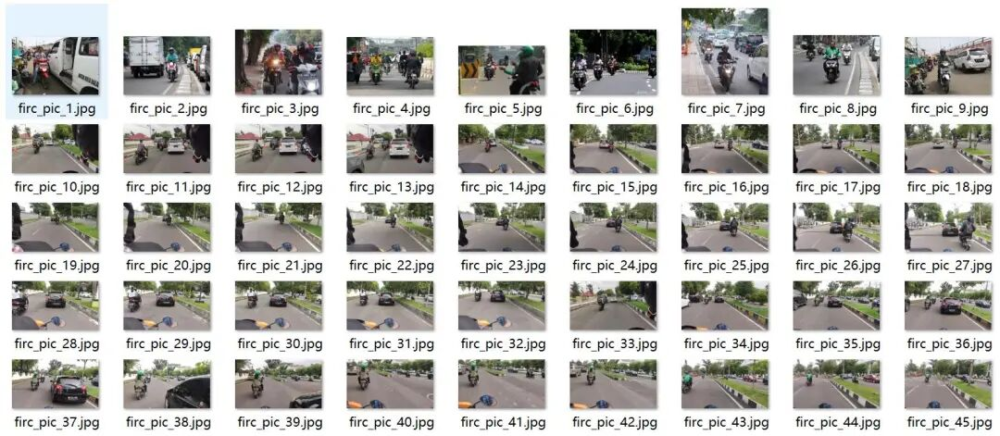
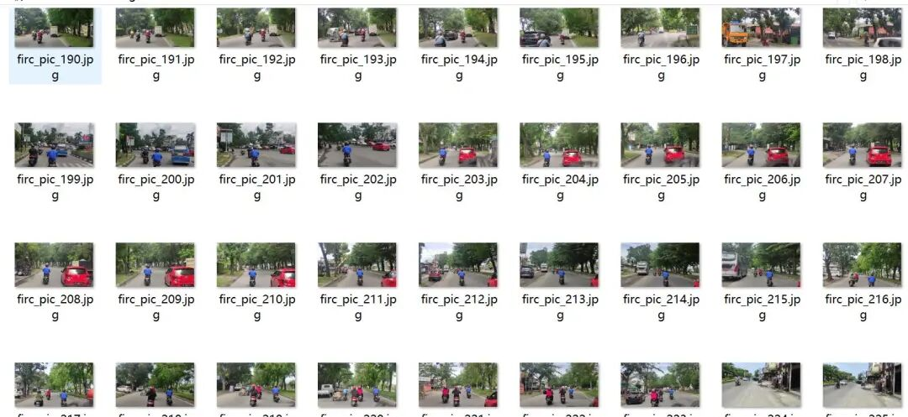
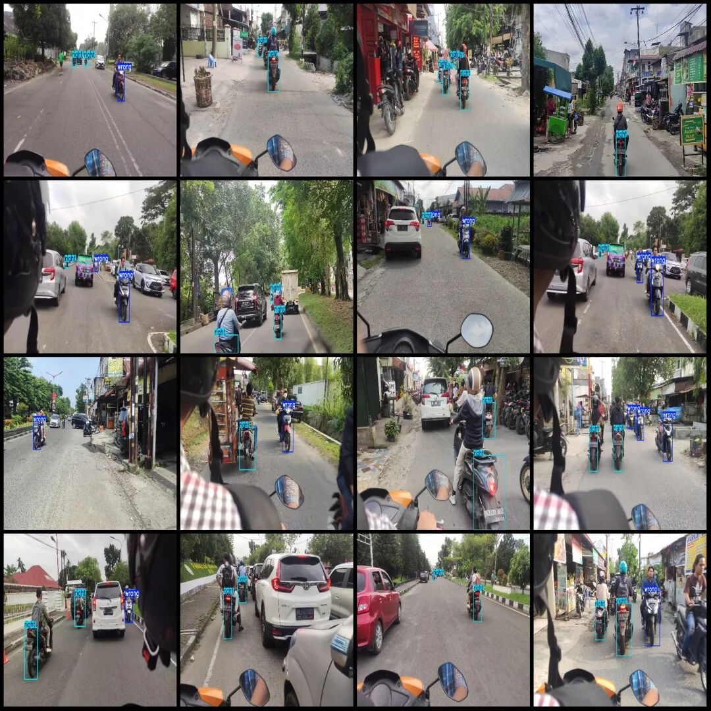
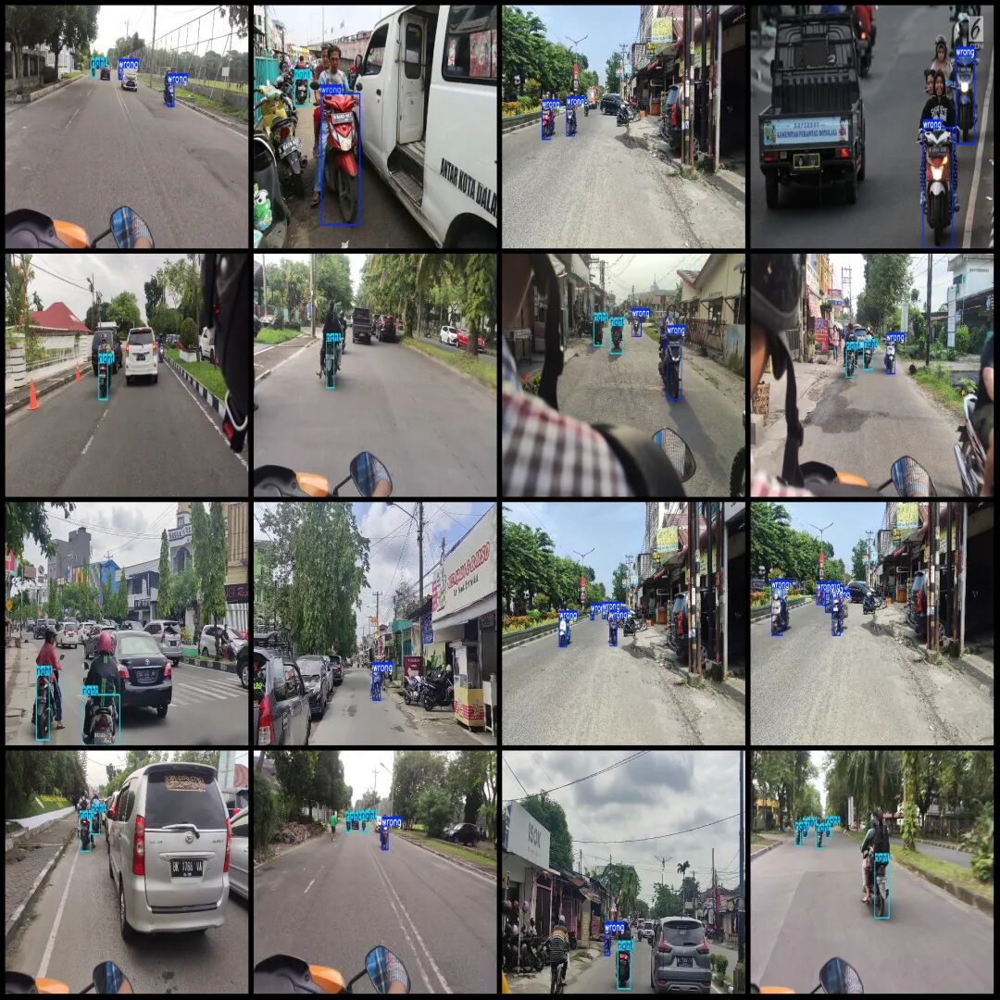

# Intelligent Traffic Electric Motorcycle Reverse Detection Dataset VOC+YOLO format with 506 images in 2 categories

Dataset format: Pascal VOC format + YOLO format (txt file without split path, only containing jpg images and corresponding VOC format xml files and yolo format txt files)

Number of images (number of jpg files): 506

Number of annotations (number of xml files): 506

Number of annotations (number of txt files): 506

Labeling category count: 2

Label category names (Note that the order of categories in the YOLO format does not correspond to this, but is based on the classes.txt file in the labels folder): ["right", "wrong"]

Number of boxes labeled in each category:

Right Frame Count = 790

Wrong number of frames = 391

Total frame count: 1181

Number of images per category:

Right Ownership Count = 397

Incorrectly, the number of images owned = 224

Image resolution: Multi-resolution, such as 3840x2160, 1920x1080 etc.

Using labelImg:

Annotation rules: Draw a rectangle around the category.

Important Notice: The dataset does not have separate training, validation, and test sets; you need to partition them yourself.

Special : This dataset does not guarantee the accuracy of the trained models or weight files.

Image Preview:

Annotation example:

## Payment

Here is a pay link on Stripe ( https://buy.stripe.com/3cs8yP7sY87d0vu9AB ). Please contact me lonlonago@foxmail.com after funding $89, and I will send you a complete data files , thank you!

